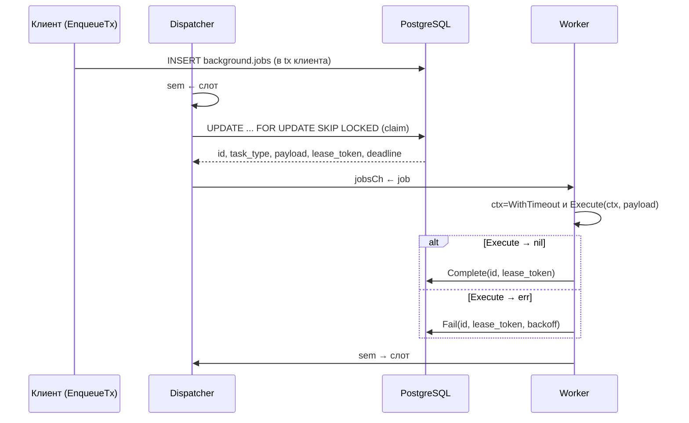
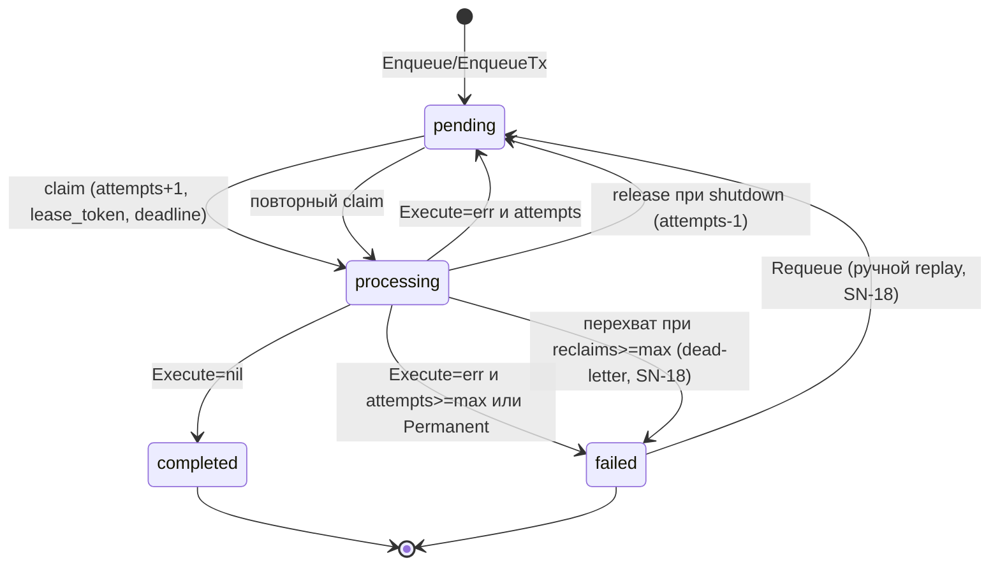

# dispoller — технический дизайн

Библиотека фоновой обработки задач для Go на базе PostgreSQL (polling + `FOR UPDATE SKIP LOCKED`).

Статус: проект утверждён, готов к реализации. Обоснование проектных решений и реестр
рисков — в [spec-notes.md](spec-notes.md); ссылки вида «SN-7» ведут к пунктам того
документа.

---

## Содержание

1. [Цель и рамки](#1-цель-и-рамки)
2. [Терминология и гарантии доставки](#2-терминология-и-гарантии-доставки)
3. [Архитектура](#3-архитектура)
4. [Модель данных (DDL)](#4-модель-данных-ddl)
5. [SQL-операции (DML)](#5-sql-операции-dml)
6. [Go API: интерфейсы и типы](#6-go-api-интерфейсы-и-типы)
7. [Движок: конкурентность и жизненный цикл](#7-движок-конкурентность-и-жизненный-цикл)
8. [Конфигурация и значения по умолчанию](#8-конфигурация-и-значения-по-умолчанию)
9. [План тестирования](#9-план-тестирования)
10. [Эксплуатация](#10-эксплуатация)
11. [Сводные компромиссы](#11-сводные-компромиссы)
12. [Roadmap (v2 и далее)](#12-roadmap-v2-и-далее)
13. [Приложение: сравнение с существующими решениями](#13-приложение-сравнение-с-существующими-решениями)

---

## 1. Цель и рамки

**Цель** — изолированная, переиспользуемая Go-библиотека (один модуль, без бизнес-логики),
реализующая очередь фоновых задач поверх PostgreSQL:

- постановка задачи — `INSERT` в таблицу `background.jobs`, в т.ч. **внутри транзакции
  клиента** (суть Transactional Outbox, см. §2);
- исполнение — in-process пул воркеров, поллящих таблицу через
  `UPDATE ... FOR UPDATE SKIP LOCKED`;
- надёжность — счётчик попыток, дедлайн выполнения (lease) с автоматическим
  перехватом «зависших» задач, защита от потери обновлений (fencing).

**В рамках:**

| Да | Нет |
|---|---|
| Одна таблица в одной PostgreSQL-БД | Шардирование, несколько БД, брокеры (Kafka/RabbitMQ) |
| At-least-once доставка | Exactly-once доставка (см. §2) |
| Ретраи с backoff, дедлайн попытки | Оркестрация, DAG, cron-расписания (v2: см. §12) |
| Горизонтальное масштабирование воркеров (несколько процессов на одной таблице) | Приоритеты очередей, изоляция task_type по пропускной способности (v2) |
| SQL-скрипт схемы + API для миграций клиента | Мигратор (миграции применяет клиент) |

**Стек:** Go (минимум 1.23; в `go.mod` фиксируется актуальная стабильная), `pgx/v5`
(`pgxpool.Pool`), стандартный `log/slog`. Внешних зависимостей, кроме `pgx`, нет.

---

## 2. Терминология и гарантии доставки

**Transactional Outbox.** Классический паттерн: бизнес-данные и «сообщение о работе»
записываются в одной транзакции БД, а отдельный процесс (relay) забирает сообщения и
исполняет их. В `dispoller` роль relay выполняют воркеры самой библиотеки, а таблица
`background.jobs` — и есть outbox. Из этого следует ключевое API-требование:
библиотека обязана уметь вставлять задачу **через `pgx.Tx` клиента**
(`EnqueueTx`), иначе «transactional» в названии паттерна теряет смысл (SN-2).

**Гарантия — at-least-once в пределах бюджетов.** Находящаяся в обороте задача будет
выполнена *как минимум* один раз; в аварийных сценариях (воркер завис и его lease
истёк, а задача на самом деле ещё дорабатывала) — возможно **повторное** выполнение.
Обороты задачи ограничены двумя бюджетами: `max_attempts` (штатные запуски) и
`max_reclaims` (восстановления после аварий); исчерпание любого переводит задачу в
наблюдаемый `failed` (dead-letter). Поэтому контракт библиотеки для клиентского кода:

> **Обработчик обязан быть идемпотентным.** Библиотека даёт at-least-once;
> exactly-once на стороне БД без бизнес-ключа идемпотентности не достижим.

Это главная цена выбранной архитектуры, неустранимая без бизнес-идемпотентности
(риск R-1, SN-15).

**Lease (аренда задачи).** При захвате воркер проставляет `must_be_finished_at = now() + execution_timeout`.
Если к этому моменту задача не финализирована — она считается потерянной (воркер упал или
завис) и может быть перехвачена другим воркером.

**Fencing token.** Токен (`lease_token UUID`), который воркер получает при захвате и
предъявляет при финализации. `UPDATE ... WHERE lease_token = $2` гарантирует, что
«опоздавший» старый воркер не перезапишет состояние задачи, уже перехваченной другим
воркером (защита от lost update; подробное обоснование — SN-4).

**Бюджет перехватов.** Каждое восстановление зависшей задачи — перехват веткой B
claim-запроса — расходует счётчик `reclaims`. Когда он достигает `max_reclaims`
(дефолт 10), очередной перехват не запускает обработчик, а переводит задачу в
`failed` (dead-letter, аналог `maxReceiveCount → DLQ` в SQS). Так серийный перезапуск
задачи, роняющей процесс при каждом выполнении, ограничен сверху. «Чистая жертва»
повторных аварий инфраструктуры теоретически может попасть в `failed` без единого
запуска — это наблюдаемо (`failed` + причина), а не тихая потеря, и обратимо через
`Requeue` (SN-18).

**Упорядочивание.** Строгого FIFO нет: `ORDER BY id` в claim-запросе даёт лишь
приблизительный порядок «старые раньше новых», который дополнительно искажается
`SKIP LOCKED` и ретраями. Если порядок важен — его обеспечивает клиент внутри одного
payload'а.

**Часы.** Все решения о времени (готовность к ретраю, истечение lease) принимает **БД**
через `now()` в SQL. Часы приложения используются только для локального таймаута
контекста обработчика и логов. Это устраняет проблемы рассинхронизации NTP между
инстансами воркеров.

---

## 3. Архитектура

Компоненты библиотеки:

```
┌─────────────────────────────── Engine ────────────────────────────────┐
│                                                                      │
│  handlers: map[task_type] → handler + execution_timeout              │
│                                                                      │
│  ┌─────────────┐   claim (1 job)   ┌──────────────────────────────┐  │
│  │ Dispatcher  │──────────────────▶│ jobsCh chan *claimedJob      │  │
│  │ (1 горутина,│                   │ (небуферизованный)           │  │
│  │  тикер      │   sem chan{}(N)   ├──────────────────────────────┤  │
│  │  interval)  │◀─────────────────▶│ Worker ×N                    │  │
│  └─────────────┘  «есть слот»      │ (горутины из пула)           │  │
│                                    └──────────┬───────────────────┘  │
│                                               │ Execute + финализация│
└───────────────────────────────────────────────┼──────────────────────┘
                                                ▼
                                         PostgreSQL
                                    background.jobs
```

- **Dispatcher** — одна горутина. По тику берёт свободный слот семафора (первый claim —
  через `interval` после старта), делает **один** claim-запрос, отправляет задачу в
  канал. Если задач нет — отпускает слот и ждёт следующего тика.
- **Семафор `sem` (канал ёмкости `concurrency`)** — ограничитель параллелизма. Слот
  берётся **до** claim: dispatcher никогда не захватывает задачу, если нет гарантии, что
  её возьмёт свободный воркер (иначе lease будет «гореть», пока задача ждёт в канале).
- **Пул из N воркеров** — фиксированные горутины, читающие небуферизованный канал.
  Инвариант: свободный слот семафора ⟺ есть воркер, не занятый задачей.
- **store** — тонкий слой над SQL (интерфейс из 5 методов). Реализация `pgStore` на
  `pgxpool.Pool`; в unit-тестах подменяется in-memory фейком (§9).

Обычно один процесс держит один `Engine`; несколько `Engine` в одном процессе тоже
корректны (claim фильтрует по зарегистрированным типам) — так можно разнести типы с
разными нагрузками (R-8). Несколько процессов (горизонтальное масштабирование)
безопасно работают с одной таблицей: `FOR UPDATE SKIP LOCKED` — это и есть координация.

Поток данных (happy path):



---

## 4. Модель данных (DDL)

Полный скрипт будет жить в `schema/schema.sql` (для тестов embed'ится в бинарник
через `go:embed`); ниже — его содержимое. Клиент применяет его своим мигратором —
библиотека мигратором не является.

```sql
CREATE SCHEMA IF NOT EXISTS background;

CREATE TABLE IF NOT EXISTS background.jobs
(
    id                  BIGINT GENERATED ALWAYS AS IDENTITY PRIMARY KEY,
    task_type           TEXT        NOT NULL,
    payload             JSONB       NOT NULL DEFAULT '{}'::jsonb,
    status              TEXT        NOT NULL DEFAULT 'pending',
    -- Дедлайн текущей попытки (lease). Инвариант протокола: NULL бывает только
    -- вне 'processing' (claim всегда ставит дедлайн, финализация стирает его).
    -- Намеренно НЕ CHECK-ограничение: строки внешних писателей (pg_restore,
    -- ручные вставки, сторонний сервис) не отклоняются, а перехватываются
    -- defensive-веткой claim'а (см. SN-5).
    must_be_finished_at TIMESTAMPTZ,
    -- Когда задача снова доступна для захвата (ретрай-пауза / отложенный запуск).
    next_attempt_at     TIMESTAMPTZ NOT NULL DEFAULT now(),
    attempts            INTEGER     NOT NULL DEFAULT 0,
    max_attempts        INTEGER     NOT NULL DEFAULT 3,
    -- Перехваты веткой B claim'а (восстановления зависших processing-строк).
    -- Бюджет ограничивает серийный перезапуск после аварий воркера (SN-18);
    -- штатный цикл claim→Fail и Release счётчик не меняют.
    reclaims            INTEGER     NOT NULL DEFAULT 0,
    max_reclaims        INTEGER     NOT NULL DEFAULT 10,
    -- Fencing-токен текущего владельца (NULL = задачи никто не держит).
    lease_token         UUID,
    error_message       TEXT,
    created_at          TIMESTAMPTZ NOT NULL DEFAULT now(),
    updated_at          TIMESTAMPTZ NOT NULL DEFAULT now(),

    CONSTRAINT jobs_status_chk       CHECK (status IN ('pending', 'processing', 'completed', 'failed')),
    CONSTRAINT jobs_attempts_chk     CHECK (attempts >= 0),
    CONSTRAINT jobs_max_attempts_chk CHECK (max_attempts >= 1),
    CONSTRAINT jobs_reclaims_chk     CHECK (reclaims >= 0),
    CONSTRAINT jobs_max_reclaims_chk CHECK (max_reclaims >= 1),
    CONSTRAINT jobs_task_type_chk    CHECK (length(task_type) BETWEEN 1 AND 255)
);
```

Четыре колонки схемы отвечают за безопасность ретраев и перехвата: `next_attempt_at`
(ретрай-пауза; без неё ретраи выжигают попытки за секунды, SN-3), `lease_token`
(fencing финализации, SN-4) и `reclaims`/`max_reclaims` (бюджет перехватов — серийный
перезапуск после аварий воркера ограничивается dead-letter'ом, SN-18).

### Индексы

```sql
-- Ветка A claim-запроса: pending, готовые по next_attempt_at.
-- Частичный: завершённые задачи в индекс не попадают, он остаётся маленьким.
CREATE INDEX jobs_pending_idx
    ON background.jobs (next_attempt_at, id)
    WHERE status = 'pending';

-- Ветка B claim-запроса: processing с истёкшим lease (кандидаты на перехват).
-- Таких строк мало (≤ общего числа воркеров), индекс крошечный.
CREATE INDEX jobs_stuck_idx
    ON background.jobs (must_be_finished_at)
    WHERE status = 'processing';

-- Для мониторинга и очистки (§10).
CREATE INDEX jobs_finished_idx
    ON background.jobs (updated_at)
    WHERE status IN ('completed', 'failed');
```

Оба поллинг-индекса покрывают свою ветку предиката `OR` — планировщик выполнит
`BitmapOr` по двум bitmap-сканам. Индекс по одному `status` пригоден лишь
для мониторинга; поллингу нужны именно частичные индексы под полный предикат (SN-13).

### Обоснование выбора типов

| Решение | Альтернатива | Почему так |
|---|---|---|
| `BIGINT IDENTITY` | `UUID` | 8 байт против 16, упорядочен (≈FIFO по `id`, компактнее лок-hot index). UUID нужен только при записи с нескольких несинхронизированных узлов — не наш случай, пишем в одну БД. SN-11 |
| `status TEXT + CHECK` | `enum` | Добавление статуса (например, `cancelled` в v2) — это `ALTER`, а не `CREATE TYPE` + перекладка колонки; миграции у клиента, эволюция должна быть дешёвой. SN-12 |
| `JSONB` payload | `JSONB` + json-schema колонка | Библиотека агностична к содержимому, валидация — обязанность обработчика |
| `TIMESTAMPTZ` | `TIMESTAMP` | Только tz-типы; все сравнения — в UTC на стороне БД |
| без триггера на `updated_at` | триггер | `updated_at` пишется явно в каждом DML библиотеки; триггер — скрытая стоимость и зависимость от объекта, которым владеет клиент |
| без таблицы истории | append-only лог попыток | v2 (SN-10): сейчас последняя ошибка в `error_message` и `attempts`-счётчик дают минимум, достаточный для очереди |

---

## 5. SQL-операции (DML)

Все запросы — статические константы с параметрами (никакой конкатенации SQL).
Соединение из пула удерживается только на время самого запроса; на время исполнения
обработчика соединение не держим.

> **Проверено.** Все запросы этого раздела и DDL §4 прогнаны на живом PostgreSQL 18
> (контейнер `postgres:18`): захват свежих/отложенных/зависших/NULL-дедлайнных задач,
> fencing (повторный Complete → 0 строк), переходы pending↔processing→completed/failed,
> release без сжигания попытки, перехват в пределах бюджета (запуск сверх
> `max_attempts`), dead-letter при исчерпанном бюджете (→ `failed`, `lease_token =
> NULL`, `attempts` не тронут), `Requeue`, `EXPLAIN` показал `BitmapOr` по
> `jobs_pending_idx` + `jobs_stuck_idx`, а двухсессионный тест подтвердил
> `SKIP LOCKED`: конкурентная сессия забрала следующую задачу за ~90 мс, не
> блокируясь на занятой строке.

### 5.1. Захват задачи (claim) — ключевая операция

Параметры: `$1 text[]` — зарегистрированные task_type, `$2 float8[]` — параллельный
массив таймаутов (сек) для каждого типа, `$3 uuid` — свежесгенерированный lease_token.

```sql
WITH cfg(task_type, timeout_seconds) AS (
    SELECT * FROM unnest($1::text[], $2::float8[])
),
candidate AS (
    SELECT c.id,
           (c.status = 'processing') AS is_reclaim,
           (c.status = 'processing' AND c.reclaims >= c.max_reclaims) AS dead_letter
    FROM background.jobs AS c
    JOIN cfg ON cfg.task_type = c.task_type
    WHERE (c.status = 'pending' AND c.next_attempt_at <= now())
       OR (c.status = 'processing'
           AND (c.must_be_finished_at IS NULL OR now() > c.must_be_finished_at))
    ORDER BY c.id
    LIMIT 1
    FOR UPDATE SKIP LOCKED
)
UPDATE background.jobs AS j
SET status              = CASE WHEN candidate.dead_letter THEN 'failed' ELSE 'processing' END,
    attempts            = CASE WHEN candidate.dead_letter THEN j.attempts ELSE j.attempts + 1 END,
    reclaims            = CASE WHEN candidate.is_reclaim THEN j.reclaims + 1 ELSE j.reclaims END,
    lease_token         = CASE WHEN candidate.dead_letter THEN NULL ELSE $3::uuid END,
    must_be_finished_at = CASE WHEN candidate.dead_letter THEN NULL
                               ELSE now() + make_interval(secs => cfg.timeout_seconds) END,
    error_message       = CASE WHEN candidate.dead_letter THEN 'reclaim budget exhausted'
                               ELSE j.error_message END,
    updated_at          = now()
FROM cfg, candidate
WHERE j.id = candidate.id
  AND j.task_type = cfg.task_type
RETURNING j.id, j.task_type, j.payload, j.attempts, j.max_attempts,
          j.reclaims, j.max_reclaims, j.lease_token, j.must_be_finished_at, j.status;
```

Разбор построчно:

- **`FOR UPDATE SKIP LOCKED`** — ядро конкурентности. Строки, уже заблокированные
  другим dispatcher'ом (в параллельной транзакции), молча пропускаются; конкуренты не
  ждут друг друга и не захватывают одну задачу дважды. Классический паттерн очередей
  на PG (так работают River, gue, Oban).
- **Атомарность одним запросом.** `UPDATE ... WHERE id = (подзапрос с блокировкой) ... RETURNING`
  — атомарный захват за один round-trip, без явного `BEGIN/COMMIT`. Альтернатива
  `BEGIN; SELECT ... FOR UPDATE SKIP LOCKED; UPDATE ...; COMMIT` корректна, но дороже.
- **`attempts = j.attempts + 1` при захвате.** Попытка инкрементируется ровно в одной
  точке — в момент захвата; на финализации только сравнение с `max_attempts` (SN-1):
  инкремент и на захвате, и на ошибке считал бы одну попытку дважды. Семантика:
  **`max_attempts` = число запусков обработчика в штатном цикле** claim→Fail: при
  `max_attempts = 3` задача выполняется максимум 3 раза. Исключение — авария воркера
  на последней попытке: ветка B перехвата не сверяется с `attempts`, и задача может
  быть запущена сверх лимита (SN-16). Серия таких перехватов ограничена бюджетом
  `max_reclaims` (SN-18, R-15): суммарный потолок запусков задачи —
  `max_attempts + max_reclaims`.
- **Ветка `OR`** покрывает оба класса кандидатов: свежие `pending` и «застрявшие»
  `processing` с истёкшим lease. `must_be_finished_at IS NULL` для `processing` —
  defensive-ветка на случай ручных вставок/восстановлений из дампа (SN-5).
- **Флаги `is_reclaim` и `dead_letter`.** Кандидат знает, какой веткой он выбран.
  Перехват (ветка B) инкрементирует `reclaims`; если бюджет исчерпан, строка **вместо
  захвата** переводится в `failed` с `error_message = 'reclaim budget exhausted'` и
  `lease_token = NULL` — это dead-letter (SN-18). Такой исход отличается в `RETURNING`
  парой (`lease_token IS NULL`, `status = 'failed'`): движок задачу не исполняет и
  немедленно повторяет claim в том же тике (§7.2) — пачка dead-letter'ов не должна
  голодать очередь по одному на тик. На `attempts` dead-letter не влияет: запуска не
  было; `reclaims` инкрементируется как у обычного перехвата — итоговое значение
  `max_reclaims + 1`, поэтому признак исчерпания для мониторинга — пара
  `status = 'failed'` + `error_message`, а не значение счётчика (§10). Сама строка
  `'reclaim budget exhausted'` — контракт мониторинга: экспортированная константа
  `ReclaimBudgetExhaustedMessage` (§6.4), её изменение — ломающее изменение для
  алертов клиентов. Штатный цикл (ветка A), Fail и Release счётчик `reclaims`
  не трогают — бюджет жгут только восстановления после аварий.
- **`JOIN cfg`** фильтрует кандидатов по зарегистрированным типам и задаёт
  **таймаут на каждый task_type** без второго round-trip. Задачи
  незарегистрированного типа не захватываются вовсе — остаются `pending` и видимы для
  мониторинга, а не выжигают попытки на ошибке «handler not found» (SN-9).
- **`now()` из БД** и в сравнениях, и в арифметике — единый источник времени.
- **`ORDER BY id LIMIT 1`** — приблизительный FIFO. Под конкуренцией `SKIP LOCKED`
  пропускает занятые строки и отдаёт следующую свободную (на PG 18 `LockRows` стоит
  под `Limit` и перебирает строки до первой незаблокированной — проверено на живом
  инстанте); пустой результат возможен, лишь если в момент запроса заняты все
  кандидаты. Для очереди это безвредно (следующий тик заберёт), задокументировано (R-9).

Ноль строк в ответе — «очередь пуста».

### 5.2. Успешное завершение (Complete)

```sql
UPDATE background.jobs
SET status = 'completed',
    error_message      = NULL,
    must_be_finished_at = NULL,
    lease_token        = NULL,
    updated_at         = now()
WHERE id = $1
  AND lease_token = $2;
```

`WHERE lease_token = $2` — fencing: если обновление затронуло **0 строк**, значит lease
уже принадлежит другому воркеру (истёк и задача перехвачена), и старый воркер **молча
отбрасывает** свой результат (лог warning). Именно поэтому «опоздавшее» повторное
выполнение при at-least-once не портит состояние задачи.

### 5.3. Ошибка (Fail)

Параметры: `$3` — сообщение, `$4` — backoff в секундах (считает движок, §7),
`$5 bool` — принудительный `failed` (перманентная ошибка, SN-8).

```sql
UPDATE background.jobs
SET status = CASE
               WHEN $5 OR attempts >= max_attempts THEN 'failed'
               ELSE 'pending'
             END,
    error_message      = $3,
    must_be_finished_at = NULL,
    lease_token        = NULL,
    next_attempt_at    = now() + make_interval(secs => $4),
    updated_at         = now()
WHERE id = $1
  AND lease_token = $2
RETURNING status;
```

`attempts` уже увеличен на claim, поэтому здесь только сравнение: после 3-го
(последнего) запуска `attempts = 3 >= max_attempts = 3` → `failed`. Backoff пишется и в
случае `failed` (не используется, но не мешает — упрощает один запрос на оба исхода).

### 5.4. Возврат при остановке (Release)

Вызывается при graceful shutdown, когда задача снята с выполнения из-за отмены
контекста движка, а не из-за ошибки обработчика. Попытка **не сжигается**:

```sql
UPDATE background.jobs
SET status = 'pending',
    attempts            = attempts - 1,
    must_be_finished_at = NULL,
    lease_token         = NULL,
    next_attempt_at     = now(),
    updated_at          = now()
WHERE id = $1
  AND lease_token = $2;
```

Счётчик `reclaims` не меняется: бюджет перехватов жгут только восстановления после
аварий, а не плановая остановка движка (SN-18).

### 5.5. Постановка задачи (Enqueue / EnqueueTx)

```sql
INSERT INTO background.jobs (task_type, payload, max_attempts, max_reclaims, next_attempt_at)
VALUES ($1, $2::jsonb, $3, $4, COALESCE($5, now()))
RETURNING id;
```

`EnqueueTx` выполняет тот же запрос на переданном `pgx.Tx` — это и есть точка
Transactional Outbox: откат бизнес-транзакции откатывает и задачу (и наоборот — задача
не видна воркерам до коммита).

### 5.6. Очистка (Purge, helper)

```sql
DELETE FROM background.jobs
WHERE id IN (
    SELECT id FROM background.jobs
    WHERE status = 'completed'
      AND updated_at < now() - make_interval(secs => $1::float8)
    LIMIT $2
);
```

Не подключена к движку; вызывается клиентом по расписанию (обычный cron/задача) через
хелпер `Purge` (§6.4), возвращающий число удалённых строк. Пакетность (`LIMIT`) — чтобы
не создавать длинные транзакции и не мешать autovacuum. Чистятся только `completed`;
`failed` не трогается (диагностика) — при необходимости удаляется ручным `DELETE` по
тому же шаблону. Подробности и риски роста таблицы — §10, R-6.

### 5.7. Возврат в очередь после failed (Requeue, helper)

Ручной replay терминальной задачи «с чистого листа» — прежде всего для пачки
dead-letter'ов, оставшихся после инфра-шторма (SN-18, R-15, R-17):

```sql
UPDATE background.jobs
SET status              = 'pending',
    attempts            = 0,
    reclaims            = 0,
    error_message       = NULL,
    must_be_finished_at = NULL,
    lease_token         = NULL,
    next_attempt_at     = now(),
    updated_at          = now()
WHERE id = $1
  AND status = 'failed'
RETURNING id;
```

Только из `failed` (0 строк → ошибка API «задача не найдена или не в failed»); оба
счётчика сбрасываются — replay означает новую жизнь задачи с полными бюджетами
попыток и перехватов. Не подключена к движку; вызывается оператором или скриптом
(bulk-replay после шторма — цикл по id, см. §10).

---

## 6. Go API: интерфейсы и типы

Пакет `dispoller` в корне модуля `github.com/bobrovka/dispoller`.
Полный список файлов — §6.6.

### 6.1. Обработчик

```go
// JobHandler реализуется в клиентском приложении.
// Обработчик ОБЯЗАН быть идемпотентным (гарантия доставки — at-least-once, см. дизайн §2).
// ctx отменяется по истечении execution_timeout task_type и при остановке движка —
// обработчик должен уважать ctx и не игнорировать его отмену.
type JobHandler interface {
    Execute(ctx context.Context, payload []byte) error
}

// HandlerFunc — адаптер для функций (аналог http.HandlerFunc).
type HandlerFunc func(ctx context.Context, payload []byte) error

func (f HandlerFunc) Execute(ctx context.Context, payload []byte) error { return f(ctx, payload) }
```

Рекомендация клиентам: перманентные ошибки (невалидный payload, «пользователь не
найден») оборачивать в `Permanent`, чтобы не тратить попытки на бессмысленные ретраи
(SN-8):

```go
// Permanent оборачивает ошибку: задача переводится сразу в failed, без ретраев.
func Permanent(err error) error

// IsPermanent сообщает, помечена ли ошибка как перманентная.
func IsPermanent(err error) bool
```

### 6.2. Регистрация обработчиков

```go
// HandlerOption настраивает обработчик при регистрации.
type HandlerOption func(*handlerConfig)

// WithExecutionTimeout задаёт дедлайн одной попытки для task_type.
// Должен быть > 0. Дефолт — WithDefaultExecutionTimeout движка.
func WithExecutionTimeout(d time.Duration) HandlerOption

// RegisterHandler привязывает обработчик к task_type.
// Возвращает ошибку при пустом task_type, nil-обработчике, d <= 0
// или повторной регистрации того же task_type.
// Не конкурентно-безопасен: вызывается до Start.
func (e *Engine) RegisterHandler(taskType string, h JobHandler, opts ...HandlerOption) error
```

Вариадик-опции дают место для per-type настроек (прежде всего таймаута), возвращаемая
ошибка ловит частые ошибки конфигурации — молчаливое затирание дубликата типа
недопустимо. SN-6.

### 6.3. Движок

```go
// New создаёт движок. pool != nil.
func New(pool *pgxpool.Pool, opts ...Option) *Engine

type Option func(*config)

func WithLogger(l *slog.Logger) Option                  // дефолт: slog.Default()
func WithDefaultExecutionTimeout(d time.Duration) Option // дефолт: 60s
func WithBackoff(base, max time.Duration) Option         // дефолт: 30s, 15m

// Start блокируется до отмены ctx, затем дожидается завершения in-flight задач
// и возвращает управление. Второй вызов — ошибка.
// interval > 0 — период опроса; concurrency >= 1 — макс. число одновременно
// выполняемых задач этим процессом.
// Возвращает ошибку при некорректных аргументах (interval <= 0, concurrency < 1,
// ни один обработчик не зарегистрирован) или повторном запуске; после
// graceful остановки возвращает nil.
func (e *Engine) Start(ctx context.Context, interval time.Duration, concurrency int) error
```

Ошибки конфигурации должны всплывать при запуске, а не теряться, поэтому `Start`
возвращает `error` (SN-6). В том числе запуск без единого зарегистрированного
обработчика: `unnest` пустого массива типов не матчит ни одной строки, и движок
молча поллил бы вхолостую, создавая нагрузку без пользы; это конфигурационная
ошибка, а не штатный режим.

### 6.4. Постановка задач

```go
type EnqueueOption func(*enqueueConfig)

func WithMaxAttempts(n int) EnqueueOption // дефолт: колонка (3)
func WithMaxReclaims(n int) EnqueueOption // дефолт: колонка (10)
func WithRunAt(t time.Time) EnqueueOption // отложенный запуск; дефолт: now()

// Enqueue вставляет задачу отдельной транзакцией пула.
func Enqueue(ctx context.Context, pool *pgxpool.Pool, taskType string, payload []byte, opts ...EnqueueOption) (int64, error)

// EnqueueTx вставляет задачу в транзакцию клиента (Transactional Outbox).
// Коммит/rollback — ответственность вызывающего.
func EnqueueTx(ctx context.Context, tx pgx.Tx, taskType string, payload []byte, opts ...EnqueueOption) (int64, error)

// Purge удаляет completed-задачи старше olderThan, батчами не более limit строк
// (SQL — §5.6), и возвращает число удалённых строк. Не подключена к движку —
// вызывайте по расписанию (§10).
func Purge(ctx context.Context, pool *pgxpool.Pool, olderThan time.Duration, limit int64) (int64, error)

// Requeue возвращает failed-задачу в очередь с чистого листа: pending, attempts=0,
// reclaims=0 (SQL — §5.7). Назначение — replay после массового dead-letter'а,
// например когда инфра-шторм выжег бюджеты перехватов (SN-18). Возвращает ошибку,
// если задача не найдена или не в failed.
func Requeue(ctx context.Context, pool *pgxpool.Pool, id int64) error

// ReclaimBudgetExhaustedMessage — значение error_message, которое claim проставляет
// задаче, переведённой в failed по исчерпанию бюджета перехватов (dead-letter,
// §5.1, SN-18). Строка — контракт мониторинга: алерт dead-letter'а (§10) матчится
// по status='failed' AND error_message = этой константе, а не по счётчику
// reclaims (после dead-letter он равен max_reclaims + 1). Изменение значения —
// ломающее изменение для алертов клиентов.
const ReclaimBudgetExhaustedMessage = "reclaim budget exhausted"
```

Аргументы валидируются до похода в БД: пустой или длиннее 255 символов `taskType`,
`WithMaxAttempts(n)` / `WithMaxReclaims(n)` при `n < 1` возвращаются как ошибки API;
ошибки CHECK БД (гонка с параллельной записью) оборачиваются с именем ограничения.

### 6.5. Пример клиентского приложения

```go
package main

import (
    "context"
    "encoding/json"
    "log/slog"
    "os"
    "os/signal"
    "time"

    "github.com/bobrovka/dispoller"
    "github.com/jackc/pgx/v5/pgxpool"
)

type SendEmailPayload struct {
    To      string `json:"to"`
    Subject string `json:"subject"`
    Body    string `json:"body"`
}

// emailClient — заглушка внешнего почтового клиента приложения (SMTP/API).
type emailClient struct{}

func (c *emailClient) Send(ctx context.Context, to, subject, body string) error {
    return nil // реальная отправка
}

// SendEmailHandler — пример бизнес-обработчика.
type SendEmailHandler struct{ cli *emailClient }

func (h *SendEmailHandler) Execute(ctx context.Context, payload []byte) error {
    var p SendEmailPayload
    if err := json.Unmarshal(payload, &p); err != nil {
        return dispoller.Permanent(err) // битый payload ретраить бессмысленно
    }
    return h.cli.Send(ctx, p.To, p.Subject, p.Body)
}

func main() {
    ctx, stop := signal.NotifyContext(context.Background(), os.Interrupt)
    defer stop()

    pool, err := pgxpool.New(ctx, os.Getenv("DATABASE_URL"))
    if err != nil {
        slog.Error("pool", "err", err)
        os.Exit(1)
    }
    defer pool.Close()

    engine := dispoller.New(pool,
        dispoller.WithLogger(slog.Default()),
        dispoller.WithDefaultExecutionTimeout(time.Minute),
    )

    if err := engine.RegisterHandler("email.send", &SendEmailHandler{cli: &emailClient{}},
        dispoller.WithExecutionTimeout(30*time.Second)); err != nil {
        slog.Error("register", "err", err)
        os.Exit(1)
    }

    // Постановка задачи в одной транзакции с бизнес-данными:
    err = pool.AcquireFunc(ctx, func(c *pgxpool.Conn) error {
        tx, err := c.Begin(ctx)
        if err != nil {
            return err
        }
        defer tx.Rollback(ctx)

        payload, err := json.Marshal(SendEmailPayload{To: "user@example.com", Subject: "hi"})
        if err != nil {
            return err
        }
        if _, err := dispoller.EnqueueTx(ctx, tx, "email.send", payload); err != nil {
            return err
        }
        // ...здесь же другие бизнес-записи в той же tx...
        return tx.Commit(ctx)
    })
    if err != nil {
        slog.Error("enqueue", "err", err)
        os.Exit(1)
    }

    // Блокируется до сигнала, затем дожидается in-flight задач.
    if err := engine.Start(ctx, time.Second, 8); err != nil {
        slog.Error("engine", "err", err)
        os.Exit(1)
    }
}
```

### 6.6. Структура репозитория

```
.
├── dispoller.go        // Engine, Option, Start
├── handler.go          // JobHandler, HandlerFunc, HandlerOption, Permanent
├── enqueue.go          // Enqueue, EnqueueTx, EnqueueOption, Purge, Requeue
├── store.go            // интерфейс store + pgStore (все SQL)
├── queries.go          // тексты SQL-запросов (константы)
├── engine_test.go      // unit-тесты (fake store)
├── integration_test.go // go:build integration; требует DISPOLLER_TEST_DSN
├── schema/
│   ├── schema.sql      // DDL из §4
│   └── schema.go       // go:embed для тестов
├── example/email/      // пример из §6.5 (компилируется в CI)
└── docs/
```

---

## 7. Движок: конкурентность и жизненный цикл

### 7.1. Состояния задачи



Переход `processing → pending` по истечении lease не меняет статус в БД: строка так и
остаётся `processing` с просроченным `must_be_finished_at`, а «переход» происходит
логически — её забирает ветка B claim-запроса. Если к этому моменту бюджет перехватов
исчерпан, вместо запуска она уходит в `failed` (dead-letter, SN-18).

Матрица «ситуация → реакция» — как система различает и разрешает проблемные ситуации
(исходы — SQL-операции §5):

| Ситуация | Как распознаётся | Реакция системы | Счётчики |
|---|---|---|---|
| Задача завершилась неуспешно, попытки остались | Fail по валидному токену, `attempts < max_attempts` | → `pending`, пауза backoff в `next_attempt_at` (§5.3) | `attempts` посчитан на claim |
| Задача завершилась неуспешно, попытки исчерпаны | Fail, `attempts >= max_attempts` | → `failed` (§5.3) | — |
| Перманентная ошибка (невалидный payload и т.п.) | Fail с force (SN-8) | → `failed` сразу, без ретраев | — |
| Обработчик пропал без вести (процесс умер/завис), бюджет перехватов не исчерпан | claim ветка B: `processing` + истёкший lease, `reclaims < max_reclaims` (§5.1) | перехват: задача запускается заново другим воркером | `attempts+1`, `reclaims+1`, новый `lease_token` |
| Обработчик пропал без вести, бюджет перехватов исчерпан | claim ветка B, `reclaims >= max_reclaims` | dead-letter: → `failed` **без запуска** обработчика, `error_message = 'reclaim budget exhausted'` (SN-18) | `reclaims+1`, `attempts` не меняется |
| Опоздавший воркер финализирует уже перехваченную задачу | Complete/Fail/Release по чужому `lease_token` → 0 строк | результат молча отбрасывается, лог warning (fencing, §5.2, SN-4) | — |
| Остановка движка с задачей на руках | отмена корневого ctx → Release (§5.4) | → `pending` без сжигания попытки | `attempts−1`, `reclaims` не меняются |
| Ручной replay после `failed` | `Requeue(id)` (§5.7) | → `pending` с чистого листа | `attempts=0`, `reclaims=0` |

### 7.2. Dispatcher

```go
// Схема псевдокода; реальный код — с полной обработкой ошибок.
func (e *Engine) dispatchLoop(ctx context.Context) {
    ticker := time.NewTicker(e.interval)
    defer ticker.Stop()
    defer close(e.jobsCh) // dispatcher — единственный отправитель (см. 7.4)

    for {
        select {
        case <-ctx.Done():
            return // graceful: см. 7.4
        case <-ticker.C:
        }

        // Внутренний цикл: один тик может дать несколько claim-запросов, т.к.
        // dead-letter-исход (бюджет перехватов исчерпан, §5.1) не приносит
        // задачу — повторяем немедленно, чтобы пачка stuck-строк после шторма
        // не голодала свежие pending по одному dead-letter'у на тик.
        for {
            // Слот берём ДО claim: не захватываем задачу, пока нет воркера,
            // который гарантированно её возьмёт (иначе lease прогорает впустую).
            select {
            case e.sem <- struct{}{}:
            case <-ctx.Done():
                return
            }

            job, err := e.store.Claim(ctx, e.types(), e.timeouts())
            if err != nil {
                <-e.sem
                if !errors.Is(err, pgx.ErrNoRows) {
                    e.log.Error("claim", "err", err) // БД недоступна — ждём следующий тик
                }
                break // ждём следующий тик
            }
            if job == nil { // очередь пуста
                <-e.sem
                break
            }
            if job.deadLettered { // перехват сверх бюджета → failed в claim (§5.1)
                <-e.sem
                e.log.Warn("job dead-lettered: reclaim budget exhausted",
                    "id", job.id, "task_type", job.taskType, "reclaims", job.reclaims)
                continue // немедленный повторный claim в этом же тике
            }

            select {
            case e.jobsCh <- job: // воркер заберёт; слот освободит воркер по завершении
            case <-ctx.Done():
                <-e.sem               // слот больше не нужен: получателя не будет
                e.releaseQuietly(job) // вернуть в pending, не сжигая попытку
                return
            }
            break // задача ушла воркеру — ждём следующий тик
        }
    }
}
```

Ключевые решения:

- **Один claim-запрос на тик на процесс** (плюс по одному на каждый dead-letter-исход,
  разбираемый немедленным повтором в том же тике, — редкие и короткие) — нагрузка
  поллинга не зависит от числа воркеров и равна `1/interval` запросов/сек на инстанс
  (дёшево: два маленьких частичных индекса).
- **Сначала слот — потом захват.** Альтернатива (захват, потом блокирующая отправка в
  канал) горит lease'ом, пока задача ждёт воркера. Отвергнута.
- **Альтернатива «каждый воркер поллит сам»** (N конкурирующих запросов на тик) даёт
  меньшую задержку при пуле воркеров, но нагружает БД и дублирует логику backpressure.
  Отвергнута; eager-пробуждение dispatcher'а после завершения задачи — в roadmap (§12, SN-14).
- `pgx.ErrNoRows` («пусто») не логируется как ошибка — это нормальный исход поллинга.
- При `Start` карта обработчиков замораживается копией для dispatcher'а; контракт —
  регистрация строго до `Start` (нарушение — гонка на map, R-3).

### 7.3. Воркер

```go
// claimedJob — задача, захваченная claim-запросом (§5.1). lease_token генерирует
// pgStore (UUID v4 из crypto/rand) в момент захвата; timeout вычисляется там же как
// must_be_finished_at − now() — часы приложения, только для локального таймаута
// обработчика (§2 «Часы»), с клампом снизу (не меньше 1s).
type claimedJob struct {
    id          int64
    taskType    string
    payload     []byte
    attempts    int
    maxAttempts int
    reclaims    int
    token       [16]byte // lease_token
    timeout     time.Duration
    // true → задача ушла в failed по бюджету перехватов прямо в claim (§5.1):
    // token нулевой, обработчик не запускать, слот освободить и повторить claim.
    deadLettered bool
}

func (e *Engine) worker(ctx context.Context) {
    for {
        select {
        case <-ctx.Done():
            return
        case job, ok := <-e.jobsCh:
            if !ok {
                return // канал закрыт при остановке
            }
            e.runWithSlot(ctx, job)
        }
    }
}

// runWithSlot гарантирует освобождение слота семафора даже при панике внутри
// библиотеки (паники обработчика перехватываются раньше, в execute, SN-7).
func (e *Engine) runWithSlot(ctx context.Context, job *claimedJob) {
    defer func() { <-e.sem }()
    e.run(ctx, job)
}

func (e *Engine) run(ctx context.Context, job *claimedJob) {
    // Локальный таймаут = lease из БД. Двойная защита:
    // БД-lease перехватывает упавшие процессы, локальный ctx — зависшие горутины.
    hctx, cancel := context.WithTimeout(ctx, job.timeout)
    defer cancel()

    err := e.execute(hctx, job) // см. паники ниже

    // Финализация — с ctx, отвязанным от корневого: при graceful shutdown корневой
    // ctx уже отменён, а Complete/Release/Fail выполнить всё равно нужно (SN-17).
    fctx, fcancel := context.WithTimeout(context.WithoutCancel(ctx), 30*time.Second)
    defer fcancel()

    switch {
    case err == nil:
        e.finalize(fctx, func() error { return e.store.Complete(fctx, job.id, job.token) })

    case isShutdown(ctx, err): // движок останавливается, попытку не сжигаем
        e.finalize(fctx, func() error { return e.store.Release(fctx, job.id, job.token) })

    default:
        backoff := e.backoffFor(job.attempts) // base * 2^(attempts-1), cap, jitter
        permanent := dispoller.IsPermanent(err)
        msg := truncate(err.Error(), 4096)
        e.finalize(fctx, func() error {
            return e.store.Fail(fctx, job.id, job.token, msg, backoff, permanent)
        })
    }
}
```

- **Паники обработчика** перехватываются в `execute` через `recover` и превращаются в
  обычную ошибку `"handler panic: ..."` → путь Fail. Паника в чужом коде не должна
  ронять процесс воркера (SN-7).
- **`isShutdown`**: `errors.Is(err, context.Canceled) && ctx.Err() != nil` — ошибка
  пришла от отмены корневого контекста движка, а не из внутренних механизмов
  обработчика. Эвристика неточная (обработчик может вернуть `context.Canceled` по своим
  причинам) — но в обоих случаях консервативно безопаснее пере-выполнить задачу, чем
  сжечь попытку: Release лишь вернёт её в очередь.
- **`finalize`** повторяет запрос финализации до 3 раз с паузами (100ms/1s/5s), т.к.
  соединение может мигрировать. Если не удалось — лог error и отказ: задача
  самовосстановится, когда истечёт её lease, и её перехватит другой воркер (двойное
  выполнение возможно — это заложенный at-least-once, R-1). Обновление, затронувшее
  0 строк (fencing потерян, §5.2), ретраям не подлежит — это нормальный исход
  (лог warning), а не ошибка соединения.
- Важно: финализация выполняется с контекстом, **отвязанным от корневого**
  (`context.WithoutCancel`, SN-17), и без таймаута попытки: даже если lease истёк или
  движок останавливается, корректная финализация по токену безопасна.

### 7.4. Graceful shutdown

1. Отмена `ctx` (сигнал ОС у клиента) → dispatcher выходит из цикла.
2. Dispatcher закрывает `jobsCh`.
3. Воркеры выходят; in-flight обработчики отменяются вместе с корневым ctx (их
   контекст — потомок корневого), задачи возвращаются через Release без сжигания
   попытки. Доработка в пределах grace-периода вместо немедленной отмены — осознанно
   отложена в v2 (SN-17).
4. `Start` ждёт все воркеры (`WaitGroup`) и возвращает `nil`.

Если процесс умер жёстко (SIGKILL, OOM) — ничего возвращать некому; задача висит в
`processing` до истечения `must_be_finished_at`, затем её перехватывает любой живой
воркер (ветка B claim). Пауза восстановления ≈ execution_timeout — плата за
отказоустойчивость без внешнего координатора.

### 7.5. Расчёт backoff

```
delay(attempts) = min(base * 2^(attempts-1) * jitter(0.8..1.2), max)
```

`attempts` — номер только что проваленной попытки (после claim). Пример при дефолтах
(base=30s, max=15m, max_attempts=3): попытка 1 → ~30s, попытка 2 → ~60s, попытка 3 →
`failed`. Jitter размазывает ретраи пачки упавших задач и применяется до cap'а —
`max` остаётся жёстким потолком задержки. Значение передаётся в
`Fail($4)` и пишется в `next_attempt_at` — БД единолично решает готовность.

---

## 8. Конфигурация и значения по умолчанию

| Параметр | Где | Дефолт | Комментарий |
|---|---|---|---|
| `interval` | `Start` | — (пример: 1s) | Компромисс задержка/нагрузка: задержка старта задачи ≤ interval; нагрузка = 1 запрос/interval/инстанс |
| `concurrency` | `Start` | — (пример: 2×CPU) | Ограничение на процесс; глобальный предел = сумма по инстансам |
| `execution_timeout` | `WithExecutionTimeout` | 60s (engine) | lease одной попытки; после истечения задача может быть перехвачена |
| `backoff base/max` | `WithBackoff` | 30s / 15m | ×2 с джиттером (§7.5) |
| `max_attempts` | колонка / `WithMaxAttempts` | 3 | Запусков обработчика в штатном цикле (исключение — SN-16) |
| `max_reclaims` | колонка / `WithMaxReclaims` | 10 | Бюджет перехватов ветки B (SN-18); щедрее реальной частоты жёстких остановок процесса (деплой без drain, eviction). Graceful shutdown бюджет не жжёт |
| пул соединений | клиент (`pgxpool`) | pgx-дефолты | `MaxConns ≥ concurrency + 2` (dispatcher + финализации); соединение не удерживается на время Execute |

---

## 9. План тестирования

### 9.1. Unit-тесты (`engine_test.go`, fake store)

Движок зависит от интерфейса `store` (`Claim/Complete/Fail/Release/Enqueue`), что даёт
проверку логики без БД:

- регистрация: дубликат типа, пустой тип, nil-обработчик, битый таймаут;
- маршрутизация payload в нужный обработчик;
- исходы `run`: nil → Complete; ошибка с попытками → Fail(pending); ошибка без попыток
  → Fail(failed); `Permanent` → Fail(failed, force); паника обработчика → Fail;
  отмена ctx движка → Release;
- dead-letter-исход claim (`deadLettered`): задача не диспетчеризуется в обработчик,
  слот семафора освобождается, dispatcher немедленно повторяет claim в том же тике;
- расчёт backoff (границы, cap, jitter-коридор);
- валидация: `Start` (interval ≤ 0, concurrency < 1, ноль зарегистрированных
  обработчиков, повторный запуск), `Enqueue` (пустой/длинный task_type,
  maxAttempts < 1);
- финализация выполняется после отмены ctx движка (`context.WithoutCancel`);
- shutdown: `Start` возвращает nil, воркеры завершаются, канал закрывается;
- конкурентность под `-race`: N воркеров × fake store с мьютексом.

### 9.2. Интеграционные тесты (`integration_test.go`)

Билд-тег `integration`; DSN из `DISPOLLER_TEST_DSN` (иначе `t.Skip`); схема применяется
из embed перед прогоном. Для локального запуска — `docker-compose.yml` c `postgres:18`
(в песочнице образ уже есть).

| # | Сценарий | Проверка |
|---|---|---|
| T-1 | Enqueue → Start | задача completed, payload доставлен |
| T-2 | ретраи | падающий обработчик: 2 неудачи → успех; статус/`attempts`/`next_attempt_at` корректны |
| T-3 | исчерпание | `max_attempts` достигнут → `failed`, `error_message` записан |
| T-4 | `Permanent` | `failed` с первой попытки, ретраев нет |
| T-5 | конкурентный захват | 2 движка × concurrency 4, 200 задач, счётчик с мьютексом: каждая задача выполнена ровно столько раз, сколько claim'ов; дублей нет |
| T-6 | дедлайн | вставка `processing`-строки с `must_be_finished_at` в прошлом → перехвачена и выполнена (симуляция упавшего воркера) |
| T-7 | fencing | длинный обработчик дольше lease: после перехвата его Complete/Fail затрагивает 0 строк, состояние не портится |
| T-8 | таймаут попытки | обработчик-«спальня» > execution_timeout: ctx отменяется, попытка провалена, ретрай |
| T-9 | graceful shutdown | снятая при остановке задача возвращается в pending без сжигания попытки; Release выполняется после отмены ctx движка; `reclaims` не меняется; `Start` возвращает nil |
| T-10 | `EnqueueTx` | rollback транзакции → задачи нет; commit → есть |
| T-11 | незарегистрированный тип | задача не захватывается, остаётся pending |
| T-12 | паника | статус failed/retry, процесс жив |
| T-13 | `Purge` | удаляет только `completed` старше порога и в рамках `limit`; `pending`/`processing`/`failed` не тронуты |
| T-14 | `WithRunAt` | отложенная задача не захватывается до наступления времени, затем выполняется |
| T-15 | NULL-дедлайн (SN-5) | `processing`-строка с `must_be_finished_at IS NULL` перехватывается и выполняется |
| T-16 | перехват сверх лимита (SN-16) | зависшая задача с `attempts = max_attempts` и неполным бюджетом перехватывается и запускается повторно — единичный запуск сверх `max_attempts` задокументирован; `reclaims` растёт |
| T-17 | бюджет перехватов (SN-18) | задача с `reclaims = max_reclaims` при перехвате уходит в `failed` без запуска обработчика (`error_message = 'reclaim budget exhausted'`, `lease_token = NULL`, `attempts` не тронут); `Requeue` возвращает её в pending с нулевыми счётчиками и задача выполняется; `Requeue` не-failed строки — 0 строк |

### 9.3. Ограничения среды

Тесты интеграционные гоняются с ограничением параллелизма: `go test -p 1` и без
`t.Parallel()` в интеграционных кейсах (среда разработки — контейнер с 4 CPU; см.
правила репозитория). `-race` включён по умолчанию в CI-команде:

```
go test -race ./...
DISPOLLER_TEST_DSN=... go test -race -tags integration -p 1 ./...
```

---

## 10. Эксплуатация

- **Нагрузка поллинга** — 1 запрос на инстанс каждый `interval`, по двум крошечным
  частичным индексам. 10 инстансов × interval 1s ≈ 10 QPS — несущественно для PG.
- **Рост таблицы.** `completed`/`failed` строки копятся: нужен периодический `Purge`
  (§5.6) — например, суточная задача с `LIMIT 10000`. `failed` стоит хранить дольше
  (диагностика). Планировать autovacuum: очередь — churn-нагрузка (R-6).
- **Мониторинг** (запросы для дашборда клиента):
  - глубина очереди: `SELECT count(*) FROM background.jobs WHERE status='pending' AND next_attempt_at <= now();`
  - застрявшие: `... WHERE status='processing' AND (must_be_finished_at < now() OR must_be_finished_at IS NULL);`
  - ошибки за час: `... WHERE status='failed' AND updated_at > now() - interval '1 hour';`
  - dead-letter по бюджету перехватов (алерт, SN-18): `SELECT id, task_type, reclaims FROM background.jobs WHERE status='failed' AND error_message='reclaim budget exhausted';` — матч по `status` + `error_message` (константа `ReclaimBudgetExhaustedMessage`, §6.4), а не по счётчику: после dead-letter `reclaims = max_reclaims + 1` (§5.1), равенство счётчика бюджету — ненадёжный признак. Пачка таких после шторма: разобрать причины и сделать bulk-replay циклом `Requeue` (§5.7);
  - незарегистрированные типы (включая «зомби»-`processing` после отката релиза, R-16): `SELECT DISTINCT task_type FROM background.jobs WHERE status IN ('pending','processing') AND task_type NOT IN (...);`
- **Безопасность.** Роли БД: enqueue-коду достаточно `INSERT`; воркерам —
  `SELECT/UPDATE` на `background.jobs`. `DELETE` нужен только джобу очистки. Payload —
  открытые данные: секреты в payload не класть (R-12).
- **Размер payload.** JSONB >2KB уходит в TOAST, распаковка на каждый claim —
  передавать ссылки (ID документов), а не содержимое (R-11).
- **Совместимость схемы.** Клиент владеет миграциями; при рассинхронизации версии схемы
  и библиотеки (например, нет колонки `lease_token`) первый же claim упадёт с понятной
  ошибкой — логируем и повторяем. Проверка схемы при старте (`SELECT` метаданных) —
  опционально в v2.

---

## 11. Сводные компромиссы

| # | Компромисс | Альтернатива | Почему принято |
|---|---|---|---|
| 1 | At-least-once (возможны дубли) | Exactly-once | Не достижимо без бизнес-идемпотентности; честно фиксируем в контракте |
| 2 | Polling с интервалом | LISTEN/NOTIFY | Проще, нет persistent-соединений; задержка ≤ interval компенсируется малым интервалом (миллисекундные тики слишком дороги, секундные — ок). NOTIFY-будильник — v2 |
| 3 | Одна таблица, один глобальный пул воркеров | Отдельные очереди/приоритеты на task_type | Минимализм v1; изоляция типов по слотам — v2 (R-8: долгий тип может занять всех воркеров) |
| 4 | Один claim-запрос = одна задача | Пакетный `LIMIT k` | Минимализм v1; пакет — очевидная оптимизация v2 без смены схемы |
| 5 | `next_attempt_at` и `lease_token` в схеме | Схема без них | Колонки закрывают классы инцидентов: мгновенное выжигание попыток и потерянные обновления при финализации (SN-3, SN-4) |
| 6 | БД-часы как истина | Часы приложения | NTP-перекос между инстансами не влияет на корректность |
| 7 | Восстановление упавшего воркера ≈ за execution_timeout | Мгновенное (heartbeat) | Внешний координатор не нужен; heartbeat-продление lease — v2 |
| 8 | Последняя ошибка только в `error_message` | Полный лог попыток | Минимализм; аудит-таблица попыток — v2 |
| 9 | Dead-letter: бюджет перехватов `max_reclaims` (SN-18) | Неограниченное восстановление после аварий | Crash-loop «ядовитой» задачи обрывается; жертва-дефект принят как в SQS `maxReceiveCount` и закрывается щедрым дефолтом, алертом и `Requeue` |

---

## 12. Roadmap (v2 и далее)

Идеи, осознанно не вошедшие в v1 (каждая — отдельное обсуждение, порядок по ценности):

1. **Eager-поллинг**: сигнал dispatcher'у сразу после освобождения слота воркером —
   уменьшение латентности без уменьшения interval (SN-14).
2. **Пакетный claim** (`LIMIT k`) — меньше round-trip при глубокой очереди.
3. **Продление lease (heartbeat)** для честно-долгих задач.
4. **Изоляция task_type**: per-type concurrency limits.
5. **Таблица `background.job_attempts`** — аудит попыток (замена компромисса 8).
6. **Dedupe-ключ** (`unique` на колонке) для защиты от дублей постановки.
7. **Cron-расписания** (`scheduled_at` + периодичность).
8. **Метрики** (интерфейс-счётчики claim/complete/fail/reclaim).
9. **Отмена задачи** (`cancelled` статус) и `LISTEN/NOTIFY`-будильник.
10. **Grace-период при остановке** (`WithShutdownGrace`) — доработка in-flight задач
    в пределах таймера вместо немедленной отмены (SN-17).

---

## 13. Приложение: сравнение с существующими решениями

Библиотека пишется с нуля, но выбор «очередь на PG» стоит делать с открытыми глазами:

| Решение | Язык | Что даёт сверх нашего v1 | Чего нет у нас |
|---|---|---|---|
| [River](https://riverqueue.com) | Go | UI, пакетный claim, периодические задачи, middleware | — |
| [gue](https://github.com/vgarvardt/gue) | Go | минимум зависимостей, похожая схематика | — |
| Oban | Elixir | приоритеты, unique-jobs, plugin-экосистема | — |
| graphile-worker | JS | batch, cron | — |
| Sidekiq/RabbitMQ | Ruby/брокер | мгновенная доставка, приоритеты | требует инфраструктуры помимо PG |

Вывод: если задача «фоновые задания в одном PG без новой инфраструктуры» — паттерн
проверен и оправдан; `dispoller` имеет право на жизнь как учебно-продуктовая
минималистичная реализация. Если появятся потребности в приоритетах/cron/UI —
сначала сравнить с River (R-13).
